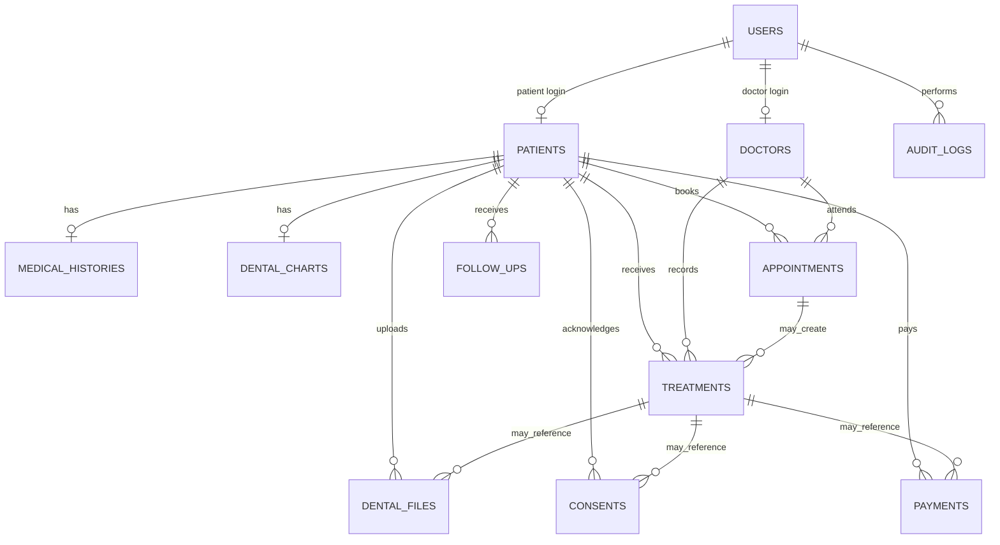

# Database design

This is a **normalized relational / OLTP schema** in PostgreSQL. It is not a star or snowflake warehouse schema: the main workload is creating and updating patient records, appointments, treatments, payments and consent records. Dashboard totals are calculated with SQL aggregate queries.

## Main relationships

## Tables

| Table | Purpose |
|---|---|
| `users` | Login identity, password hash, role and active status |
| `patients` | Clinic patient profile and unique patient code |
| `doctors` | Doctor information linked to a doctor login |
| `medical_histories` | Allergies, conditions, medication and previous surgery details |
| `appointments` | Visit date/time, patient, doctor and status |
| `treatments` | Procedure, tooth number, diagnosis, notes and charges |
| `dental_files` | File metadata and R2 object key; image bytes are not stored in PostgreSQL |
| `consents` | Treatment consent text and patient acknowledgement status |
| `payments` | Amount, payment method and payment status |
| `follow_ups` | Follow-up due date, notes and status |
| `dental_charts` | Flexible chart data in PostgreSQL `JSONB` |
| `audit_logs` | Selected access and record-change audit events |

## Storage separation

- PostgreSQL stores structured data, relationships, access roles and audit records.
- Cloudflare R2 stores photos, X-rays and PDF documents in a private bucket.
- `dental_files.object_key` connects a patient record to the private R2 object.
- A user must pass the API authorization check before the API creates a short-lived download URL.

This keeps binary files out of the relational database while retaining patient-linked metadata and access control.
